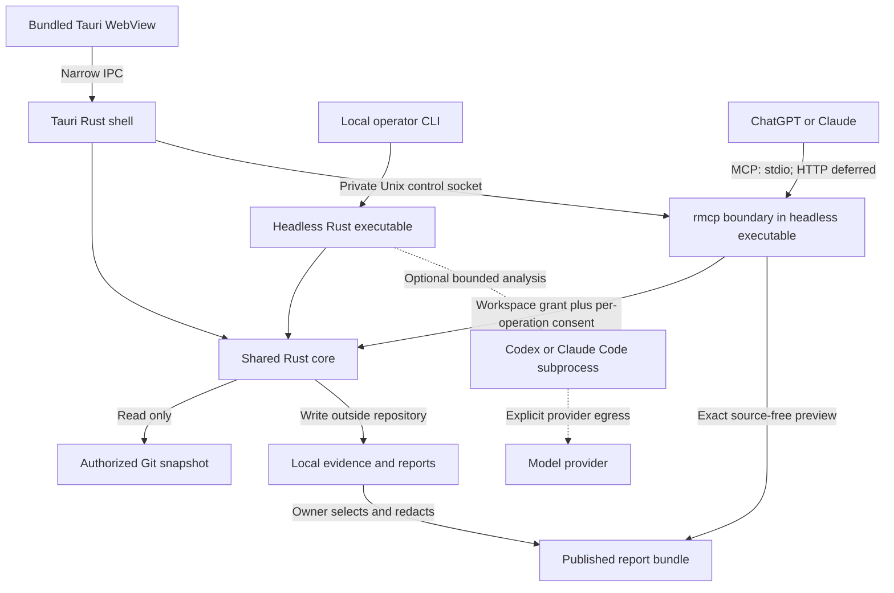

# Architecture

Status: core/CLI, Phase 2A desktop and Phase 2B local consent-controlled stdio are implemented within their recorded limits. Actual host interoperability, providers and remote operation remain unverified or deferred. See [Phase 2B receipt](phase-2b.md). See [ADRs](decisions.md) for rationale and [compatibility](compatibility.md) for external facts.

## Responsibilities and dependency direction

Use a shared Rust library, a headless executable, and a Tauri 2 desktop shell. The diagram shows logical responsibilities, not services to deploy now.

| Component | Owns | Does not own |
| --- | --- | --- |
| Shared core | Root registration policy, snapshot manifest, deterministic checks, evidence validation, report generation, export filtering | Tauri, MCP wire protocol, model authentication, shell execution |
| Headless executable | Operator audit/export commands; rmcp consent gateway mode; optional adapter driver; remote batch invocation | A second audit engine, generic command execution, a scheduler fleet |
| Tauri shell | Native folder selection, audit lifecycle, local report viewing, export consent; calls core in process | Raw filesystem/shell access from JavaScript; mandatory background daemon |
| Local store | Versioned JSON records, immutable evidence blobs, generated Markdown, separately selected published bundles | Cloud synchronization, a vector index, an initial database service |
| Optional adapter | Convert a bounded evidence package into schema-validated candidate findings | Register roots, widen scope, declare tests passed, mutate authoritative evidence |
| Optional remote runner | Same headless executable and core on a separately operated machine | Access to a sleeping Mac, automatic two-way sync, shared SaaS tenancy |

The core has no dependency on Tauri, rmcp, or either provider. Transport DTOs map into core types. Start with static checks for repository structure, manifests, CI/test declarations, and evidence-linked observations. Describe their exact coverage; no general security certification or whole-program correctness claim.

When implementation starts, the intended maximum initial layout is `crates/audit-core/`, `crates/audit-host/`, and `desktop/` (with Tauri's conventional `src-tauri/`). Adapter drivers stay modules in audit-host. Do not create these directories until their phase needs them. React/TypeScript/Vite and git2 are selected in the implementation receipts.

## One audit from input to report

1. The operator registers one repository through native UI or local CLI. The backend canonicalizes the root, rejects overlap with its application-data directory, and issues an opaque repository ID. MCP cannot register roots.
2. Resolve a requested commit into its full object ID. Read committed blobs and tree entries using a Git library without checkout, filters, hooks, external Git helpers, submodule traversal, or LFS downloads. Record ignored submodules, symlinks, and LFS pointers as exclusions. Initial coverage excludes the worktree, untracked files, and external dependencies.
3. Apply file/type/size/count limits and secret-path exclusions before persisting excerpts. Collect only required evidence, with hashes of the exact bytes inspected. Snapshot identity is the commit plus the selected-file manifest and policy version. An absent Git repository or unresolved commit fails explicitly; working-copy capture is a later decision.
4. Run deterministic checks against that fixed input. An optional adapter receives only an owner-approved evidence package; its output is validated and stored as a separate analysis result. Never replace original evidence with model prose.
5. Finalize JSON and render Markdown from it. Publish a run only after an atomic finalization; interrupted runs remain incomplete. The local viewer can inspect incomplete results with a clear status. External MCP exposes only finalized, owner-selected bundles.

Reports describe a snapshot, not a continuously current repository. Always show capture time, commit and manifest identity, exclusions, and last-known freshness. A remote snapshot cannot be labeled current for the Mac without comparing explicitly supplied identities.

## Minimum evidence contract

This is the contract baseline. Phase 1 implements local run/evidence/finding/check records in audit-core; provider receipts and remote import/export schemas remain planned. JSON is the canonical report; Markdown is a derived view.

| Record | Required information |
| --- | --- |
| Run | Schema version, run/repository IDs, local or remote origin, timestamps, commit ID, manifest digest, policy/check versions, requested scope, covered/excluded files, completion status |
| Evidence | Stable ID within run, relative path, blob/content hash, line or byte range, minimal excerpt or artifact reference, collector/version, capture status and exclusion/redaction reason |
| Finding | ID, title, severity with rationale, observed/inferred/unverified classification, evidence IDs, recommendation, limitations; provider provenance when used |
| Check receipt | Check ID/version, input identity, success/failure/skipped/unavailable status, reason and bounded output references; command/exit status only if a later execution mode actually runs one |
| Analysis receipt | Adapter and executable version, provider/model if reported, input evidence digest, prompt/template version, duration, outcome, usage if supplied (otherwise unknown) |

A report with no findings can still have incomplete coverage. “No findings in inspected scope” never means all tests passed or the repository is safe. Invalid evidence references reject a candidate finding; missing artifacts remain unavailable, never silently zero or successful. Hashes establish content identity, not trust in a remote machine or correctness of a claim.

Redacted exports are separate artifacts: retain the source evidence ID and original hash, mark omitted/transformed ranges, and hash the exported bytes separately. Never present a redacted excerpt as the original bytes. Export validation checks that report references resolve within that bundle; unavailable evidence stays explicitly unavailable.

Each run writes into a unique private temporary directory, then atomically finalizes it. Readers ignore unfinished directories. No concurrent edits to finalized runs; corrections make a new revision referring to the prior run. No database, index, event bus, or job queue initially. A single operator-run job is enough; interrupted work is retried as a new run. Store permissions are owner-only; encryption at rest is not yet implemented. Retention and deletion cover evidence, bundles, and temporary files; downstream provider copies cannot be recalled by local deletion.

## Assistant and adapter boundaries

**MCP exposes registered workspace operations, never arbitrary filesystem access.** ADR-004 was explicitly amended for Phase 2B. The tools are `list_workspaces`, `get_workspace_summary`, `start_audit`, `get_audit_status`, and `get_audit_report`. Core Workspace registration/storage contracts are shared by desktop and headless modes; reader handles cannot register/select roots. The gateway owns session authorization and worker lifecycle; Core owns snapshot policy and evidence integrity. See [the wire/consent contract](gateway-contract.md).

All scopes default deny. Workspace grants allow only discovery, audit requests or report requests; they do not approve execution or publication. Exact audit requests require local application consent, then run a bounded fixed Core worker. Report publication requires approval of the exact frozen source-free metadata projection and releases it once. Other tool results contain approved workspace metadata/status only. `start_audit` and `get_audit_report` have readOnlyHint false because they create/consume consequential consent state. Annotations and host dialogs never authorize access. No evidence-content, shell, registration, upload or generic file tool is exposed.

Each `audit-host mcp PROFILE` serves all registered roots for one stdio session; up to eight sessions share the profile. Their grants, control sockets and journals are isolated. A profile-wide worker lease serializes MCP audits. The desktop connects through an owner-only local control socket; its lifetime does not own the gateway. Closing host stdin shuts only that session and its active worker down; other sessions remain live. Closing/reopening desktop storage works while the gateway reads fresh registries; changes still need fresh explicit grants. No HTTP listener, tunnel client or host configuration is provisioned.

Claude Desktop's documented local path is stdio; actual Orven host connectivity remains unverified. Official ChatGPT custom MCP supports a URL or Secure MCP Tunnel, subject to account/workspace policy. The tunnel can forward to stdio, but requires correct Platform/workspace associations and runtime credentials; current account eligibility is unknown. An authenticated remote HTTP boundary would need separate implementation before exposure. These are compatibility paths, not current connectivity claims. See [current official-source research](phase-2b-compatibility.md).

Codex and Claude Code are optional **outbound analysis adapters**, separate from ChatGPT/Claude as inbound MCP clients. Initial candidate interfaces are Codex App Server over subprocess stdio and Claude Code's non-interactive structured output. Neither is rmcp's MCP protocol. No official native Rust Agent SDK is assumed. The desktop can invoke the headless helper for optional analysis rather than duplicating drivers. A missing executable, unsupported version, absent authentication, provider failure, or rejected budget leaves the deterministic report usable with analysis marked unavailable.

## Security boundaries

The threat model includes malicious repository files, prompt injection, compromised WebView content, unauthorized MCP callers, and malformed imported bundles. A compromised owner OS, remote administrator, or model provider is outside the protection the local application can guarantee.

| Boundary | Required enforcement |
| --- | --- |
| Repository → core | Read immutable Git blobs; treat documentation/AGENTS.md as data. Do not load project plugins, execute config, follow tree symlinks/submodules, or resolve source URLs. Bound traversal, parser input, decompression, memory and runtime. Restrict Git metadata/object-store access to approved locations; reject alternate object stores or external gitdir paths unless separately authorized. |
| WebView → Rust | Bundled assets only, restrictive CSP, sanitized Markdown with raw HTML disabled and no automatic remote resources. Explicitly scope capabilities and app commands to the intended window; no frontend shell/filesystem plugin permissions or remote-content IPC. Backend validates IDs and policy on every command. Tauri ACLs do not sandbox Rust. |
| Store → assistant/provider | Default deny. Owner previews the exact redacted bundle, destination and allowed report scope before enabling access. Secret exclusions and scanning are defense in depth; explicit consent is still needed for source excerpts. MCP metadata, errors, logs and identifiers must not leak absolute paths or secrets. |
| MCP caller → bundle | Stdio receives only session/workspace-scoped metadata and separately consented operations under the OS user. Private local control is trusted only within that same owner account. HTTP requires TLS, valid issuer/audience/expiry/scopes, protected-resource discovery and OAuth-compatible authorization, plus per-report access checks. Use an established authorization provider; no bespoke identity service. Validate Origin when present, restrict Host, bound requests and rate-limit. Bind backend HTTP to loopback behind the selected gateway; never expose an unauthenticated repository endpoint. |
| Evidence → optional agent process | Untrusted text cannot grant tools. Launch a pinned/validated executable with structured arguments, isolated configuration/home and scratch workspace; disable repository/user hooks, skills, plugins and auto-discovery. No source checkout or inherited unrelated credentials. Deny tool execution and filesystem mutation outside scratch; enforce OS isolation and provider-only network egress, time/output/cost limits. Prompt instructions and CLI permission flags alone are insufficient. Keep adapter disabled until this is demonstrated on its target OS. |
| Remote/import → local store | Explicit machine and repository authorization, authenticated transfer, commit/manifest comparison, schema/hash validation, bounded size, rejection of traversal and unsafe archive entries. Treat returned claims as remote-origin evidence. Never extract into the audited repository, merge worktrees, or overwrite a local run. |

Read-only means no intentional mutation of repository content, index, refs, or configuration. It does not mean no application writes, no disclosure, an OS sandbox, or a guarantee about filesystem access-time metadata. No repository builds/tests are allowed initially: their scripts can write and access the network even when a model calls them “read-only.” Adding execution or remediation needs a new ADR and isolated execution policy.

## Optional remote mode and offline behavior

Choose a simple single-owner runner, not a synchronization platform. The operator provisions a fixed snapshot on that machine via an explicit transfer or an independently authorized read-only repository acquisition. Transfers list included source and exclusions; fetching credentials are separate from MCP credentials. Acquisition occurs outside the network-disabled deterministic audit. No arbitrary repository URL from an MCP caller.

Run the same headless audit as a batch job, store results on runner-local disk, and optionally serve only approved bundles through authenticated HTTPS MCP. The report-serving process has access to published bundles, not source snapshots or acquisition credentials. No server on the Mac is required once the runner has the approved input. Initially the operator starts jobs through their existing authenticated machine access; no remote job API, cloud account system, broker, or autoscaling.

| Situation | Expected behavior |
| --- | --- |
| Mac offline, no remote copy | Local checks/viewer work on available local data. Cloud assistants cannot request a fresh Mac audit. |
| Mac sleeps, runner has commit A | Runner can audit A and serve its reports to connected hosts. Unsent commit B and dirty Mac changes remain unavailable. |
| Tunnel runs only on sleeping Mac | Connection is unavailable. A tunnel does not supply persistent compute or replicate files. |
| Mac reconnects | Operator imports a selected validated report bundle; IDs, origin and snapshot identity are preserved. No automatic overwrite or reconciliation. |
| Runner/provider unavailable | Existing local reports remain usable; remote/AI work is unavailable or failed, with no silent local upload or fallback provider. |

Runner OS, hosting, transfer format and sandbox mechanism remain unresolved. Their security and operational proof is required before enabling remote mode, not before building a useful local audit.

The separately authorized [Cloud Handoff Phase A](../cloud/handoff/README.md) selects
GitHub for upstream browser identity only (ADR-006). It uses the existing Worker/D1
modules, not the Rust audit engine, and grants no repository authority. MCP OAuth
authorization-server behavior and live remote interoperability remain unimplemented.

[Cloud Handoff Phase A.1](desktop-auth.md) adds an opt-in GitHub identity section to
the existing desktop settings. Its browser-confirmed loopback handoff yields a
revocable desktop credential stored in macOS Keychain. Rust Core validates callback
and profile policy, and the shell supplies OS/network adapters. GitHub tokens and
browser cookies never enter the desktop. Account identity confers no audit, target,
repository-writing, MCP or device-inbox authority. Avatar bytes are downloaded only
by Rust from the fixed GitHub avatar host and delivered as bounded image data; the
WebView CSP's network policy remains unchanged.
